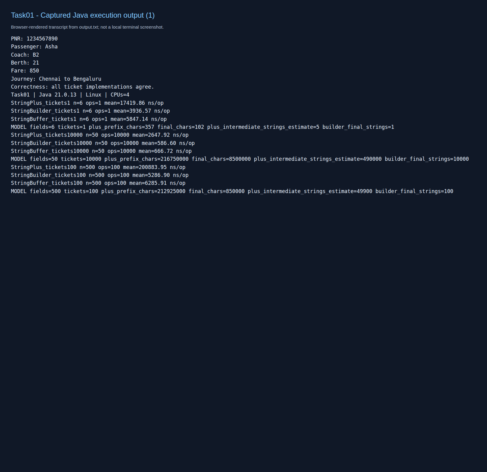
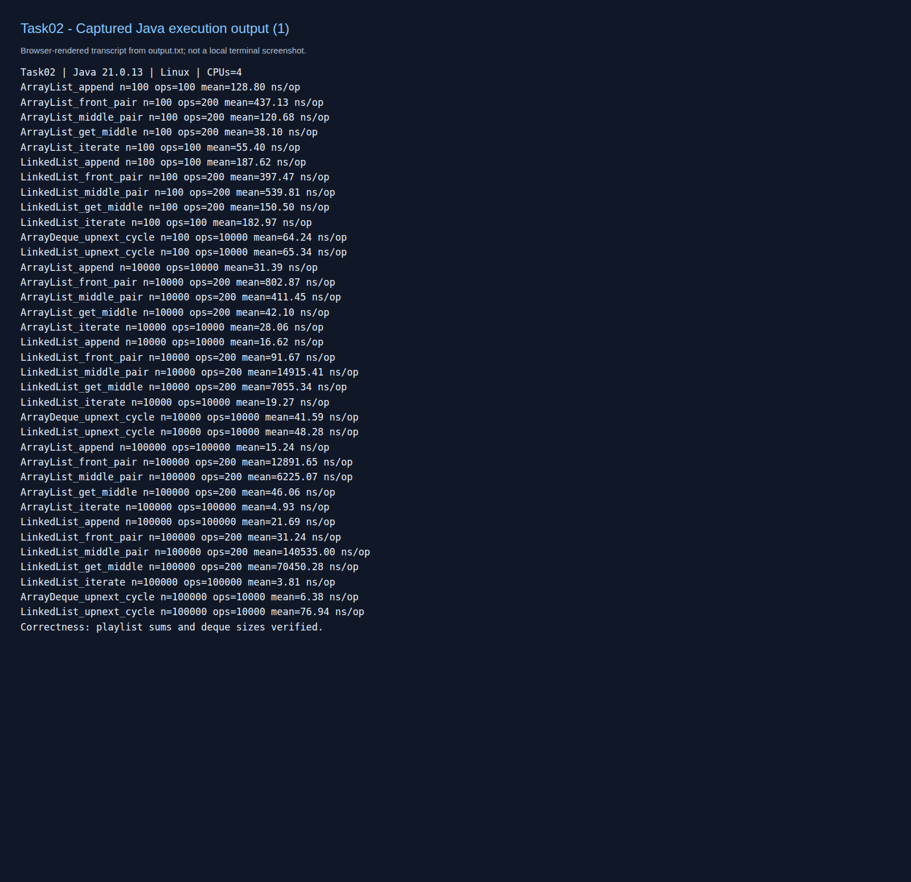
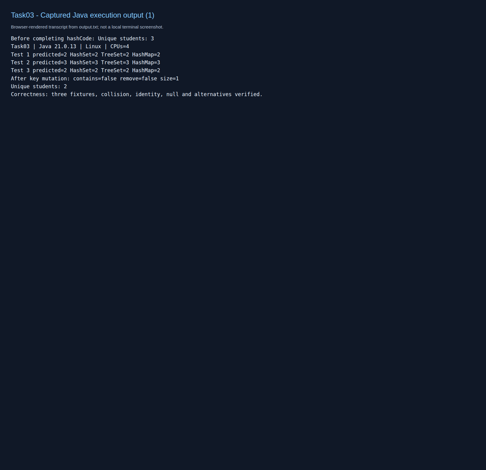
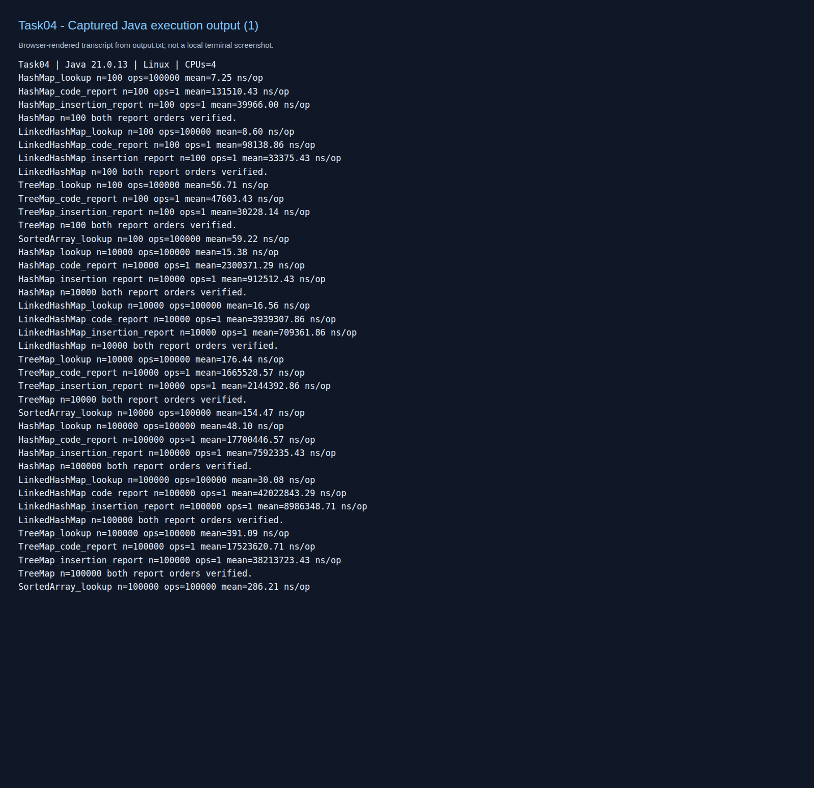
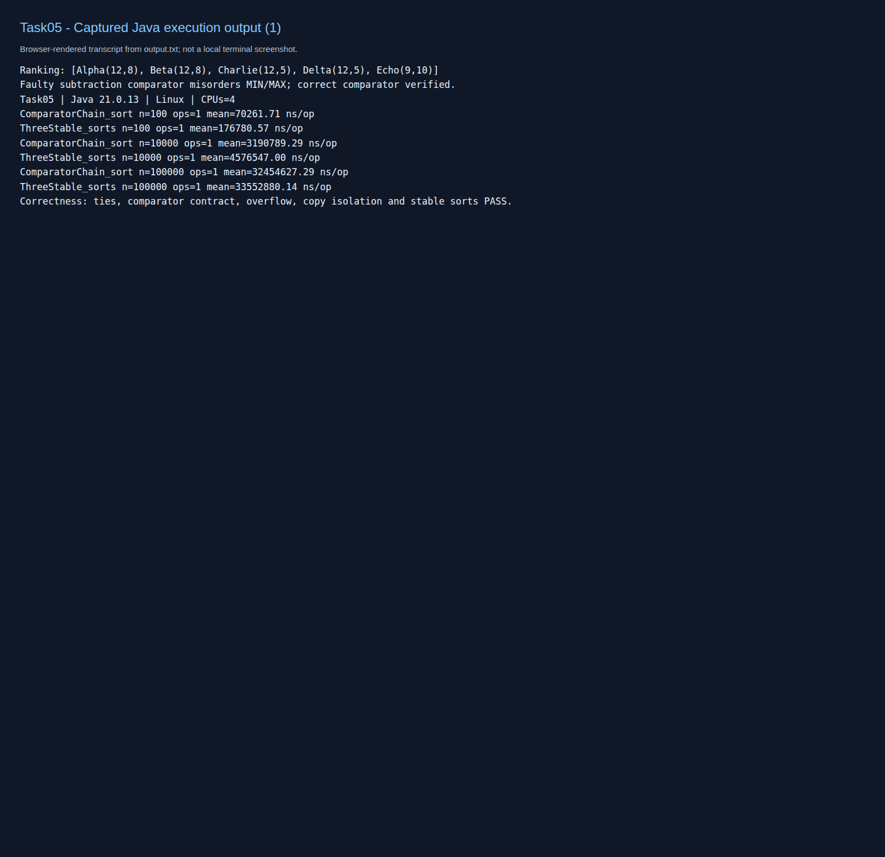
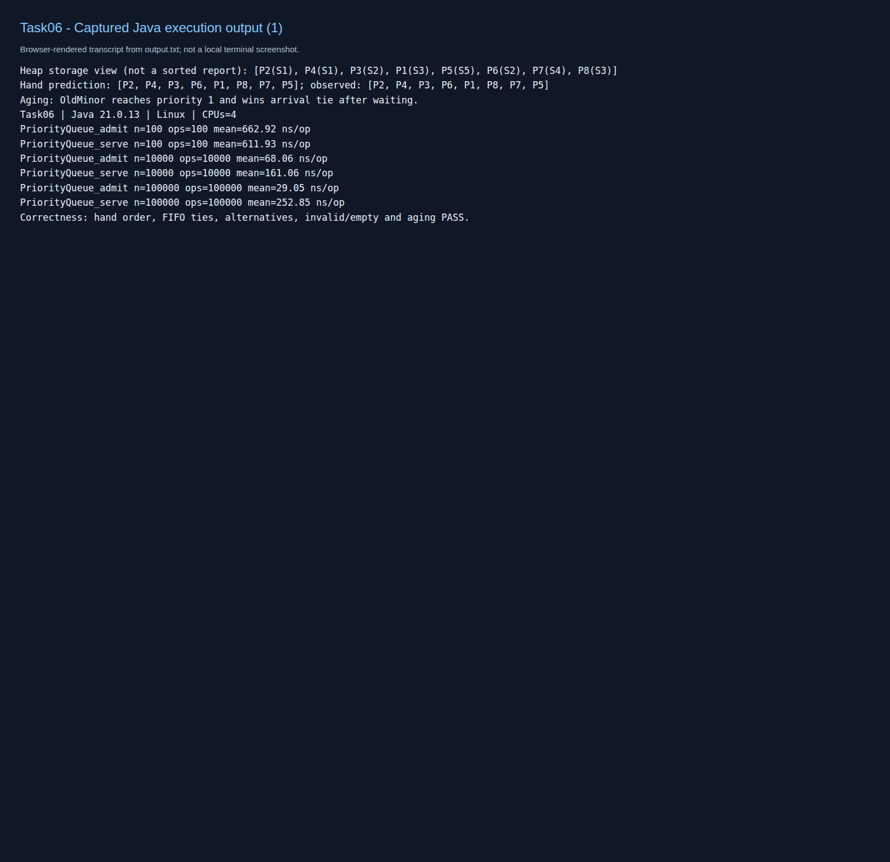
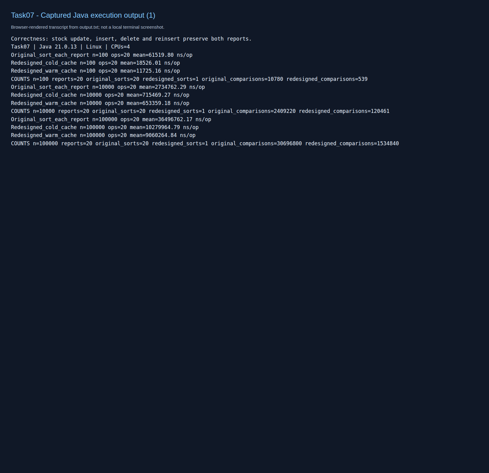

# Assignment 2 (CO2) - Report and measured evidence

Repository: https://github.com/UMManishsagar/CSA0916

**Student name/register number: not supplied; complete before submission.**

This is an AI-assisted implementation and analysis with genuine automated execution evidence. It does not certify individual student execution or faculty approval. The student must review, run and explain the work. Task plans were committed before the automated run. 

## Execution environment

```text
UTC: 2026-11-15T14:40:54Z
openjdk version "21.0.13" 2026-10-20 LTS
OpenJDK Runtime Environment Temurin-21.0.13+9 (build 21.0.13+9-LTS)
OpenJDK 64-Bit Server VM Temurin-21.0.13+9 (build 21.0.13+9-LTS, mixed mode, sharing)
javac 21.0.13
Linux runnervmccnms 7.0.0-1019-azure #20-Ubuntu SMP PREEMPT Mon Oct 19 22:41:16 UTC 2026 x86_64 GNU/Linux
Source commit: 35611f9babb19c9d7ad0b758b204ccb370822e6c
Runner: GitHub Actions 1000000000
4
Architecture:                            x86_64
CPU op-mode(s):                          32-bit, 64-bit
Address sizes:                           48 bits physical, 57 bits virtual
Byte Order:                              Little Endian
CPU(s):                                  4
On-line CPU(s) list:                     0-3
Vendor ID:                               GenuineIntel
Model name:                              INTEL(R) XEON(R) PLATINUM 8573C
CPU family:                              6
Model:                                   207
Thread(s) per core:                      2
Core(s) per socket:                      2
Socket(s):                               1
Stepping:                                2
CPU(s) scaling MHz:                      154%
CPU max MHz:                             2300.0000
CPU min MHz:                             800.0000
BogoMIPS:                                4599.99
Flags:                                   fpu vme de pse tsc msr pae mce cx8 apic sep mtrr pge mca cmov pat pse36 clflush mmx fxsr sse sse2 ss ht syscall nx pdpe1gb rdtscp lm constant_tsc rep_good nopl xtopology tsc_reliable nonstop_tsc cpuid aperfmperf tsc_known_freq pni pclmulqdq vmx ssse3 fma cx16 pcid sse4_1 sse4_2 x2apic movbe popcnt tsc_deadline_timer aes xsave avx f16c rdrand hypervisor lahf_lm abm 3dnowprefetch tpr_shadow ept vpid ept_ad fsgsbase tsc_adjust bmi1 hle avx2 smep bmi2 erms invpcid rtm avx512f avx512dq rdseed adx smap avx512ifma clflushopt clwb avx512cd sha_ni avx512bw avx512vl xsaveopt xsavec xgetbv1 xsaves user_shstk avx_vnni avx512_bf16 vnmi avx512vbmi umip waitpkg avx512_vbmi2 gfni vaes vpclmulqdq avx512_vnni avx512_bitalg avx512_vpopcntdq la57 rdpid cldemote movdiri movdir64b fsrm serialize tsxldtrk ibt amx_bf16 avx512_fp16 amx_tile amx_int8 arch_capabilities
Virtualization:                          VT-x
Hypervisor vendor:                       Microsoft
Virtualization type:                     full
L1d cache:                               96 KiB (2 instances)
L1i cache:                               64 KiB (2 instances)
L2 cache:                                4 MiB (2 instances)
L3 cache:                                260 MiB (1 instance)
NUMA node(s):                            1
NUMA node0 CPU(s):                       0-3
Vulnerability Gather data sampling:      Not affected
Vulnerability Ghostwrite:                Not affected
Vulnerability Indirect target selection: Mitigation; Aligned branch/return thunks
Vulnerability Itlb multihit:             Not affected
Vulnerability L1tf:                      Not affected
Vulnerability Mds:                       Not affected
Vulnerability Meltdown:                  Not affected
Vulnerability Mmio stale data:           Not affected
Vulnerability Old microcode:             Not affected
Vulnerability Reg file data sampling:    Not affected
Vulnerability Retbleed:                  Vulnerable
Vulnerability Spec rstack overflow:      Not affected
Vulnerability Spec store bypass:         Vulnerable
Vulnerability Spectre v1:                Mitigation; usercopy/swapgs barriers and __user pointer sanitization
Vulnerability Spectre v2:                Mitigation; Retpolines; STIBP disabled; RSB filling; PBRSB-eIBRS Not affected; BHI Retpoline
Vulnerability Srbds:                     Not affected
Vulnerability Tsa:                       Not affected
Vulnerability Tsx async abort:           Not affected
Vulnerability Vmscape:                   Not affected
```

## Measurement method and limitations

Three warmups and seven recorded samples per timed case. Setup is outside System.nanoTime(); CSV durations cover the complete operation batch. Mean ns/op divides mean batch time by the reported operation count. SD is sample standard deviation across seven batch durations. A playlist pair/cycle, a whole report, and a whole sort each count as one labelled operation. The small educational harness uses one JVM per task, a fixed case order and no isolated forks; JIT/GC/host contention and shared runner noise can change rankings. Reused String keys may already have cached hashes. Finite timings support these tested workloads; they do not prove asymptotic complexity or production tail latency.

heap_before/heap_after are raw Runtime occupancy readings WITHOUT forced GC. They cannot be interpreted as exact allocation or retained-size measurements. Q1 prefix-copy/object estimates and Q7 instrumented comparison counts provide complementary evidence.

---

# Q1 - Building text under load

## Prediction and experiment plan (written before execution)

Compare one 6-field ticket, 10,000 tickets of 50 fields, and 100 unusually long tickets of 500 fields. Fields have equal length. Repeated `+` should copy growing prefixes; builders should scale approximately with final text length. At tiny sizes timer noise can exceed differences. StringBuffer may cost more because it synchronizes, but a JVM can remove uncontended synchronization, so its relative timing is not guaranteed.

## Design and complexity

For n fields of fixed length k, repeated concatenation copies k(1+2+...+n), giving O(kn^2) total copying/allocation; amortized StringBuilder growth gives O(kn). Peak live space can be O(kn) for both when earlier prefixes are collectible; cumulative temporary allocation is the quadratic difference, not necessarily quadratic live heap. The printed String estimate counts n-1 intermediate results plus one final result per ticket, not literal JVM allocations or backing arrays; modern concatenation uses implementation-dependent optimizations. Heap snapshots are noisy occupancy readings, not allocation measurements.

Use a local StringBuilder per ticket. For a shared StringBuffer log, synchronize around the WHOLE booking record, not merely individual append calls, to prevent interleaving. An alternative is build a full record locally and append it under a shared lock; a logging queue/single consumer can reduce contention. StringBuffer alone does not make arbitrary compound operations atomic.

`String.join("\n", fields) + "\n"` and `StringJoiner` are implemented and checked against the builders. For total output length L they use O(L) work/storage under normal library implementations. `String.format("PNR: %s%nPassenger: %s%n", pnr, name)` is convenient for fixed templates but incurs format parsing and conversions; a single pass is proportional to the formatted output plus formatting costs. Repeated `format` plus concatenation inside a loop reintroduces prefix copying.

## Interpretation

Use the generated measurements in REPORT.md. Timing includes the same final String hash traversal for all modes and excludes field creation. Do not generalize a single tiny workload or declare a universal StringBuffer slowdown.

### Observed execution evidence

[Raw samples](Task01/results/raw.csv) | [Complete stdout](Task01/results/output.txt)

| Case | Size | Ops/sample | Mean batch ms | Median ms | SD ms | Mean ns/op |
|---|---:|---:|---:|---:|---:|---:|
| StringPlus_tickets1 | 6 | 1 | 0.0174 | 0.0182 | 0.0028 | 17419.86 |
| StringBuilder_tickets1 | 6 | 1 | 0.0039 | 0.0039 | 0.0015 | 3936.57 |
| StringBuffer_tickets1 | 6 | 1 | 0.0058 | 0.0031 | 0.0077 | 5847.14 |
| StringPlus_tickets10000 | 50 | 10,000 | 26.4792 | 21.5796 | 10.1328 | 2647.92 |
| StringBuilder_tickets10000 | 50 | 10,000 | 5.8660 | 5.8206 | 0.2329 | 586.60 |
| StringBuffer_tickets10000 | 50 | 10,000 | 6.6672 | 6.6339 | 0.2326 | 666.72 |
| StringPlus_tickets100 | 500 | 100 | 20.0884 | 19.8880 | 0.5484 | 200883.95 |
| StringBuilder_tickets100 | 500 | 100 | 0.5287 | 0.5257 | 0.0063 | 5286.90 |
| StringBuffer_tickets100 | 500 | 100 | 0.6286 | 0.6273 | 0.0281 | 6285.91 |

```text
PNR: 1234567890
Passenger: Asha
Coach: B2
Berth: 21
Fare: 850
Journey: Chennai to Bengaluru
Correctness: all ticket implementations agree.
Task01 | Java 21.0.13 | Linux | CPUs=4
StringPlus_tickets1 n=6 ops=1 mean=17419.86 ns/op
StringBuilder_tickets1 n=6 ops=1 mean=3936.57 ns/op
StringBuffer_tickets1 n=6 ops=1 mean=5847.14 ns/op
MODEL fields=6 tickets=1 plus_prefix_chars=357 final_chars=102 plus_intermediate_strings_estimate=5 builder_final_strings=1
StringPlus_tickets10000 n=50 ops=10000 mean=2647.92 ns/op
StringBuilder_tickets10000 n=50 ops=10000 mean=586.60 ns/op
StringBuffer_tickets10000 n=50 ops=10000 mean=666.72 ns/op
MODEL fields=50 tickets=10000 plus_prefix_chars=216750000 final_chars=8500000 plus_intermediate_strings_estimate=490000 builder_final_strings=10000
StringPlus_tickets100 n=500 ops=100 mean=200883.95 ns/op
StringBuilder_tickets100 n=500 ops=100 mean=5286.90 ns/op
StringBuffer_tickets100 n=500 ops=100 mean=6285.91 ns/op
MODEL fields=500 tickets=100 plus_prefix_chars=212925000 final_chars=850000 plus_intermediate_strings_estimate=49900 builder_final_strings=100
```

Browser screenshots of captured stdout generated successfully.



---

# Q2 - Music playlist editor

## Prediction and experiment plan

Test 100, 10,000 and 100,000 preconstructed Song objects. Time append batches, 200 insert/remove pairs at front and middle, 200 middle-index reads, and one full iterator traversal. A pair keeps size constant; its ns/op is the combined insertion AND removal, not either separately. Test 10,000 Up Next cycles (two additions and two removals) in both deques.

## Analysis and decision rule

ArrayList append is amortized O(1), indexed access O(1), front/middle insert and remove O(n), traversal O(n), space O(n) with spare capacity. LinkedList append and front edits are O(1), indexed middle operations O(n) because locating the node dominates; relinking is O(1) ONLY once a node/iterator is already located. Its traversal is O(n), but nodes add reference/allocation overhead and reduce locality. Indexed `for` traversal would make LinkedList O(n^2), so use its iterator.

Default to ArrayList for append/read/iterate playlists. Define an illustrative interactive edit budget of 1 ms per insert/remove pair; the generated report checks tested sizes against it. This is a measured average boundary for these workloads, not a universal maximum size or tail-latency guarantee. Even below that threshold, sustained front-edit traffic makes ArrayDeque a better API for Up Next. ArrayDeque supports amortized O(1) additions/removals at both ends, O(n) storage, and no random indexed access; it cannot replace a full editor requiring arbitrary k-th access.

For cursor-local repeated middle edits a retained LinkedList ListIterator can justify LinkedList, whereas repeated index-based middle edits do not. Timing ratios and absolute budgets must be interpreted alongside actual usage frequency.

### Observed execution evidence

[Raw samples](Task02/results/raw.csv) | [Complete stdout](Task02/results/output.txt)

| Case | Size | Ops/sample | Mean batch ms | Median ms | SD ms | Mean ns/op |
|---|---:|---:|---:|---:|---:|---:|
| ArrayList_append | 100 | 100 | 0.0129 | 0.0120 | 0.0036 | 128.80 |
| ArrayList_front_pair | 100 | 200 | 0.0874 | 0.0899 | 0.0093 | 437.13 |
| ArrayList_middle_pair | 100 | 200 | 0.0241 | 0.0231 | 0.0023 | 120.68 |
| ArrayList_get_middle | 100 | 200 | 0.0076 | 0.0072 | 0.0022 | 38.10 |
| ArrayList_iterate | 100 | 100 | 0.0055 | 0.0054 | 0.0004 | 55.40 |
| LinkedList_append | 100 | 100 | 0.0188 | 0.0160 | 0.0072 | 187.62 |
| LinkedList_front_pair | 100 | 200 | 0.0795 | 0.0802 | 0.0253 | 397.47 |
| LinkedList_middle_pair | 100 | 200 | 0.1080 | 0.0994 | 0.0255 | 539.81 |
| LinkedList_get_middle | 100 | 200 | 0.0301 | 0.0262 | 0.0082 | 150.50 |
| LinkedList_iterate | 100 | 100 | 0.0183 | 0.0183 | 0.0023 | 182.97 |
| ArrayDeque_upnext_cycle | 100 | 10,000 | 0.6424 | 0.6382 | 0.2916 | 64.24 |
| LinkedList_upnext_cycle | 100 | 10,000 | 0.6534 | 0.6525 | 0.0775 | 65.34 |
| ArrayList_append | 10,000 | 10,000 | 0.3139 | 0.3159 | 0.0953 | 31.39 |
| ArrayList_front_pair | 10,000 | 200 | 0.1606 | 0.1593 | 0.0056 | 802.87 |
| ArrayList_middle_pair | 10,000 | 200 | 0.0823 | 0.0806 | 0.0039 | 411.45 |
| ArrayList_get_middle | 10,000 | 200 | 0.0084 | 0.0075 | 0.0019 | 42.10 |
| ArrayList_iterate | 10,000 | 10,000 | 0.2806 | 0.3063 | 0.1505 | 28.06 |
| LinkedList_append | 10,000 | 10,000 | 0.1662 | 0.1666 | 0.0054 | 16.62 |
| LinkedList_front_pair | 10,000 | 200 | 0.0183 | 0.0176 | 0.0012 | 91.67 |
| LinkedList_middle_pair | 10,000 | 200 | 2.9831 | 2.9923 | 0.1227 | 14915.41 |
| LinkedList_get_middle | 10,000 | 200 | 1.4111 | 1.4098 | 0.0063 | 7055.34 |
| LinkedList_iterate | 10,000 | 10,000 | 0.1927 | 0.1588 | 0.0439 | 19.27 |
| ArrayDeque_upnext_cycle | 10,000 | 10,000 | 0.4159 | 0.4169 | 0.0147 | 41.59 |
| LinkedList_upnext_cycle | 10,000 | 10,000 | 0.4828 | 0.4814 | 0.0105 | 48.28 |
| ArrayList_append | 100,000 | 100,000 | 1.5244 | 0.9763 | 1.3107 | 15.24 |
| ArrayList_front_pair | 100,000 | 200 | 2.5783 | 2.5745 | 0.0110 | 12891.65 |
| ArrayList_middle_pair | 100,000 | 200 | 1.2450 | 1.2282 | 0.0664 | 6225.07 |
| ArrayList_get_middle | 100,000 | 200 | 0.0092 | 0.0059 | 0.0085 | 46.06 |
| ArrayList_iterate | 100,000 | 100,000 | 0.4930 | 0.2434 | 0.3293 | 4.93 |
| LinkedList_append | 100,000 | 100,000 | 2.1690 | 1.5400 | 2.4397 | 21.69 |
| LinkedList_front_pair | 100,000 | 200 | 0.0062 | 0.0030 | 0.0087 | 31.23 |
| LinkedList_middle_pair | 100,000 | 200 | 28.1070 | 28.0960 | 0.0447 | 140535.00 |
| LinkedList_get_middle | 100,000 | 200 | 14.0901 | 14.0677 | 0.0533 | 70450.28 |
| LinkedList_iterate | 100,000 | 100,000 | 0.3808 | 0.3664 | 0.0299 | 3.81 |
| ArrayDeque_upnext_cycle | 100,000 | 10,000 | 0.0638 | 0.0534 | 0.0191 | 6.38 |
| LinkedList_upnext_cycle | 100,000 | 10,000 | 0.7694 | 0.7671 | 0.0130 | 76.94 |

```text
Task02 | Java 21.0.13 | Linux | CPUs=4
ArrayList_append n=100 ops=100 mean=128.80 ns/op
ArrayList_front_pair n=100 ops=200 mean=437.13 ns/op
ArrayList_middle_pair n=100 ops=200 mean=120.68 ns/op
ArrayList_get_middle n=100 ops=200 mean=38.10 ns/op
ArrayList_iterate n=100 ops=100 mean=55.40 ns/op
LinkedList_append n=100 ops=100 mean=187.62 ns/op
LinkedList_front_pair n=100 ops=200 mean=397.47 ns/op
LinkedList_middle_pair n=100 ops=200 mean=539.81 ns/op
LinkedList_get_middle n=100 ops=200 mean=150.50 ns/op
LinkedList_iterate n=100 ops=100 mean=182.97 ns/op
ArrayDeque_upnext_cycle n=100 ops=10000 mean=64.24 ns/op
LinkedList_upnext_cycle n=100 ops=10000 mean=65.34 ns/op
ArrayList_append n=10000 ops=10000 mean=31.39 ns/op
ArrayList_front_pair n=10000 ops=200 mean=802.87 ns/op
ArrayList_middle_pair n=10000 ops=200 mean=411.45 ns/op
ArrayList_get_middle n=10000 ops=200 mean=42.10 ns/op
ArrayList_iterate n=10000 ops=10000 mean=28.06 ns/op
LinkedList_append n=10000 ops=10000 mean=16.62 ns/op
LinkedList_front_pair n=10000 ops=200 mean=91.67 ns/op
LinkedList_middle_pair n=10000 ops=200 mean=14915.41 ns/op
LinkedList_get_middle n=10000 ops=200 mean=7055.34 ns/op
LinkedList_iterate n=10000 ops=10000 mean=19.27 ns/op
ArrayDeque_upnext_cycle n=10000 ops=10000 mean=41.59 ns/op
LinkedList_upnext_cycle n=10000 ops=10000 mean=48.28 ns/op
ArrayList_append n=100000 ops=100000 mean=15.24 ns/op
ArrayList_front_pair n=100000 ops=200 mean=12891.65 ns/op
ArrayList_middle_pair n=100000 ops=200 mean=6225.07 ns/op
ArrayList_get_middle n=100000 ops=200 mean=46.06 ns/op
ArrayList_iterate n=100000 ops=100000 mean=4.93 ns/op
LinkedList_append n=100000 ops=100000 mean=21.69 ns/op
LinkedList_front_pair n=100000 ops=200 mean=31.24 ns/op
LinkedList_middle_pair n=100000 ops=200 mean=140535.00 ns/op
LinkedList_get_middle n=100000 ops=200 mean=70450.28 ns/op
LinkedList_iterate n=100000 ops=100000 mean=3.81 ns/op
ArrayDeque_upnext_cycle n=100000 ops=10000 mean=6.38 ns/op
LinkedList_upnext_cycle n=100000 ops=10000 mean=76.94 ns/op
Correctness: playlist sums and deque sizes verified.
```

Browser screenshots of captured stdout generated successfully.



---

# Q3 - Equality and hashing

## Predictions before execution

1. R1, R1, R2: corrected size 2; the equals-only class normally retains all three separate instances because identity hashes differ (not a universal guaranteed set size).
2. R1, R2, R3: corrected size 3.
3. Aa, BB, Aa: size 2 despite Aa and BB sharing a String hash; unequal colliding keys must coexist.

Also check re-adding the same object, equality across different names, null/type safety, and modifying a hashed field after insertion. A mutable key stored as A and changed to B is searched using its NEW hash while it remains placed using its OLD hash. `contains` and `remove` fail in this deliberately selected fixture; results for arbitrary mutations/bucket coincidences are not guaranteed.

## Explanation and alternatives

HashSet uses a HashMap: a spread hash selects a bucket and stored hashes/equality distinguish entries. Equal objects MUST have equal hashes; the reverse is not required. Without hashCode, overriding equals alone does not reliably de-duplicate separately allocated scans. Make the identity field immutable, base both methods on regNo, and do not include mutable display names. Student is final so subclass equality cannot introduce asymmetry. In real input normalize/validate registration numbers according to an explicit identity policy before construction.

HashSet and HashMap keyed by regNo need O(n) space and expected O(1) per scan with suitable hashing (not a strict worst-case guarantee). HashMap's putIfAbsent explicitly retains the first scan's details. TreeSet with `Comparator.comparing(Student::regNo)` needs O(log n) per scan and O(n) space; comparator equality defines uniqueness and here agrees with equals. String hashing/comparison also depends on registration-number length.

The supplied PDF cuts off the original Complete-the-Code program after the constructor on page 7. Attendance.java preserves the visible private final regNo/name fields and constructor pattern, completes the contract, and reconstructs a three-scan demonstration of the stated `Unique students: 2` output. The broken class is intentionally kept separately for before/after execution; this is not claimed as a verbatim recovery of the missing source.

### Observed execution evidence

[Raw samples](Task03/results/raw.csv) | [Complete stdout](Task03/results/output.txt)

Q3 uses deterministic correctness experiments; no performance timings are claimed.

```text
Before completing hashCode: Unique students: 3
Task03 | Java 21.0.13 | Linux | CPUs=4
Test 1 predicted=2 HashSet=2 TreeSet=2 HashMap=2
Test 2 predicted=3 HashSet=3 TreeSet=3 HashMap=3
Test 3 predicted=2 HashSet=2 TreeSet=2 HashMap=2
After key mutation: contains=false remove=false size=1
Unique students: 2
Correctness: three fixtures, collision, identity, null and alternatives verified.
```

Browser screenshots of captured stdout generated successfully.



---

# Q4 - Pharmacy inventory maps

## Prediction and experimental design

Use 100, 10,000 and 100,000 synthetic medicine codes, inserted in a seeded shuffled order. Each collection handles exactly the same 100,000 seeded successful queries and creates both complete formatted reports. Also verify absent keys. Lookup setup, query generation and initial construction are outside timing. Each report sample includes formatting and correctness comparison, so this is end-to-end in-memory report generation, not just sorting. No console/disk printing is timed.

Predict expected O(1) HashMap/LinkedHashMap lookup versus O(log n) TreeMap/binary-search lookup. Set an illustrative average in-memory budget of 10 microseconds per lookup; the report checks that budget using mean batch time / 100,000. This does not establish a p99 or user-facing network/database response guarantee.

## Design choice

LinkedHashMap preserves insertion order and expected constant-time stock lookups. Sort a copy of its keys for the evening code-order report: O(n log n) comparisons and O(n) temporary references. TreeMap keeps code order at O(log n) insertion/lookup and O(n) traversal; it still needs an additional insertion-history list for the second report. HashMap needs both explicit sorting and insertion-history metadata. In the implementation all maps use common report functions (with map.get); that adds O(n log n) lookup work to a TreeMap report, although an optimized entrySet traversal would produce it in O(n). The experiment should not confuse that implementation choice with a TreeMap lower bound.

For lookup-heavy traffic and infrequent evening reports, deploy LinkedHashMap if measured averages meet the budget. Sorting/formatting, memory allocation and potentially persistence/I/O remain costs; O(1) lookup does not mean zero latency. Hashtable synchronizes each method, has legacy API constraints and does not make multi-step transactions atomic. Prefer ordinary maps under suitable external locking or ConcurrentHashMap for an explicitly concurrent requirement; LinkedHashMap itself is not thread-safe.

## Sorted-array alternative

Store medicines sorted by code, use Arrays.binarySearch(keys, code), and access a parallel stock array at the returned index. Lookup uses O(log n) comparisons, insertion/deletion uses O(n) shifts and occasional resizing, code-order output is O(n), and space is O(n). The measured alternative demonstrates lookup, and checks missing keys; preserving insertion order requires a separate timestamp/history index. HashMap/LinkedHashMap expected insertion and lookup are O(1); TreeMap insert/lookup are O(log n). All store O(n) data, with different node/reference overhead. Code string length affects hash and comparison work.

### Observed execution evidence

[Raw samples](Task04/results/raw.csv) | [Complete stdout](Task04/results/output.txt)

| Case | Size | Ops/sample | Mean batch ms | Median ms | SD ms | Mean ns/op |
|---|---:|---:|---:|---:|---:|---:|
| HashMap_lookup | 100 | 100,000 | 0.7245 | 0.6686 | 0.1829 | 7.25 |
| HashMap_code_report | 100 | 1 | 0.1315 | 0.1307 | 0.0314 | 131510.43 |
| HashMap_insertion_report | 100 | 1 | 0.0400 | 0.0400 | 0.0030 | 39966.00 |
| LinkedHashMap_lookup | 100 | 100,000 | 0.8596 | 0.7822 | 0.2328 | 8.60 |
| LinkedHashMap_code_report | 100 | 1 | 0.0981 | 0.0962 | 0.0218 | 98138.86 |
| LinkedHashMap_insertion_report | 100 | 1 | 0.0334 | 0.0338 | 0.0026 | 33375.43 |
| TreeMap_lookup | 100 | 100,000 | 5.6713 | 5.6115 | 0.1330 | 56.71 |
| TreeMap_code_report | 100 | 1 | 0.0476 | 0.0461 | 0.0078 | 47603.43 |
| TreeMap_insertion_report | 100 | 1 | 0.0302 | 0.0276 | 0.0075 | 30228.14 |
| SortedArray_lookup | 100 | 100,000 | 5.9222 | 5.9271 | 0.0497 | 59.22 |
| HashMap_lookup | 10,000 | 100,000 | 1.5385 | 1.5117 | 0.0667 | 15.38 |
| HashMap_code_report | 10,000 | 1 | 2.3004 | 2.1625 | 0.4837 | 2300371.29 |
| HashMap_insertion_report | 10,000 | 1 | 0.9125 | 0.9072 | 0.0119 | 912512.43 |
| LinkedHashMap_lookup | 10,000 | 100,000 | 1.6562 | 1.4546 | 0.4227 | 16.56 |
| LinkedHashMap_code_report | 10,000 | 1 | 3.9393 | 3.3320 | 1.6139 | 3939307.86 |
| LinkedHashMap_insertion_report | 10,000 | 1 | 0.7094 | 0.6318 | 0.1551 | 709361.86 |
| TreeMap_lookup | 10,000 | 100,000 | 17.6441 | 17.5238 | 0.2205 | 176.44 |
| TreeMap_code_report | 10,000 | 1 | 1.6655 | 1.6338 | 0.1117 | 1665528.57 |
| TreeMap_insertion_report | 10,000 | 1 | 2.1444 | 2.2206 | 0.1505 | 2144392.86 |
| SortedArray_lookup | 10,000 | 100,000 | 15.4471 | 15.3722 | 0.2023 | 154.47 |
| HashMap_lookup | 100,000 | 100,000 | 4.8101 | 5.0674 | 0.6928 | 48.10 |
| HashMap_code_report | 100,000 | 1 | 17.7004 | 16.8440 | 3.8315 | 17700446.57 |
| HashMap_insertion_report | 100,000 | 1 | 7.5923 | 7.4506 | 0.3085 | 7592335.43 |
| LinkedHashMap_lookup | 100,000 | 100,000 | 3.0085 | 3.0165 | 0.0404 | 30.08 |
| LinkedHashMap_code_report | 100,000 | 1 | 42.0228 | 40.3524 | 2.7611 | 42022843.29 |
| LinkedHashMap_insertion_report | 100,000 | 1 | 8.9863 | 8.2414 | 2.5893 | 8986348.71 |
| TreeMap_lookup | 100,000 | 100,000 | 39.1089 | 39.0208 | 0.1906 | 391.09 |
| TreeMap_code_report | 100,000 | 1 | 17.5236 | 16.7438 | 1.9042 | 17523620.71 |
| TreeMap_insertion_report | 100,000 | 1 | 38.2137 | 37.5816 | 1.5885 | 38213723.43 |
| SortedArray_lookup | 100,000 | 100,000 | 28.6210 | 28.6285 | 0.1139 | 286.21 |

```text
Task04 | Java 21.0.13 | Linux | CPUs=4
HashMap_lookup n=100 ops=100000 mean=7.25 ns/op
HashMap_code_report n=100 ops=1 mean=131510.43 ns/op
HashMap_insertion_report n=100 ops=1 mean=39966.00 ns/op
HashMap n=100 both report orders verified.
LinkedHashMap_lookup n=100 ops=100000 mean=8.60 ns/op
LinkedHashMap_code_report n=100 ops=1 mean=98138.86 ns/op
LinkedHashMap_insertion_report n=100 ops=1 mean=33375.43 ns/op
LinkedHashMap n=100 both report orders verified.
TreeMap_lookup n=100 ops=100000 mean=56.71 ns/op
TreeMap_code_report n=100 ops=1 mean=47603.43 ns/op
TreeMap_insertion_report n=100 ops=1 mean=30228.14 ns/op
TreeMap n=100 both report orders verified.
SortedArray_lookup n=100 ops=100000 mean=59.22 ns/op
HashMap_lookup n=10000 ops=100000 mean=15.38 ns/op
HashMap_code_report n=10000 ops=1 mean=2300371.29 ns/op
HashMap_insertion_report n=10000 ops=1 mean=912512.43 ns/op
HashMap n=10000 both report orders verified.
LinkedHashMap_lookup n=10000 ops=100000 mean=16.56 ns/op
LinkedHashMap_code_report n=10000 ops=1 mean=3939307.86 ns/op
LinkedHashMap_insertion_report n=10000 ops=1 mean=709361.86 ns/op
LinkedHashMap n=10000 both report orders verified.
TreeMap_lookup n=10000 ops=100000 mean=176.44 ns/op
TreeMap_code_report n=10000 ops=1 mean=1665528.57 ns/op
TreeMap_insertion_report n=10000 ops=1 mean=2144392.86 ns/op
TreeMap n=10000 both report orders verified.
SortedArray_lookup n=10000 ops=100000 mean=154.47 ns/op
HashMap_lookup n=100000 ops=100000 mean=48.10 ns/op
HashMap_code_report n=100000 ops=1 mean=17700446.57 ns/op
HashMap_insertion_report n=100000 ops=1 mean=7592335.43 ns/op
HashMap n=100000 both report orders verified.
LinkedHashMap_lookup n=100000 ops=100000 mean=30.08 ns/op
LinkedHashMap_code_report n=100000 ops=1 mean=42022843.29 ns/op
LinkedHashMap_insertion_report n=100000 ops=1 mean=8986348.71 ns/op
LinkedHashMap n=100000 both report orders verified.
TreeMap_lookup n=100000 ops=100000 mean=391.09 ns/op
TreeMap_code_report n=100000 ops=1 mean=17523620.71 ns/op
TreeMap_insertion_report n=100000 ops=1 mean=38213723.43 ns/op
TreeMap n=100000 both report orders verified.
SortedArray_lookup n=100000 ops=100000 mean=286.21 ns/op
```

Browser screenshots of captured stdout generated successfully.



---

# Q5 - Generic ranking component

## Design before execution

Rank by points descending, goal difference descending, then name ascending. A chain of total field orders is lexicographic: the first unequal field decides, preserving antisymmetry and transitivity. All equal field values compare as zero. Two distinct Team objects can be ranking-equivalent; this is a list ordering, not a deduplicating set. If used in a TreeSet, define equals consistently with ranking identity or add a unique team identifier as a final key.

Choose injected Comparator objects because teams may have several valid rankings and the same Leaderboard<T> can rank players or colleges. Comparator<? super T> accepts an ordering for T or its supertype; List<? extends T> supplies T or subtype items. T needs no artificial Comparable bound when the comparator is injected. The natural helper demonstrates the meaningful bounded alternative `<U extends Comparable<? super U>>`. Predict O(n log n) comparison work and O(n) working/copy space for ranking.

## Correctness and alternative designs

The ties fixture tests every key and checks original insertion order/copy isolation. The adversarial fixture contains Integer.MIN_VALUE/MAX_VALUE to break subtraction comparators and equivalent duplicate field values to check comparison zero. Exhaustive small-fixture pair/triple checks cover symmetry, transitivity and zero-equivalence substitution. Integer.compare/comparingInt avoid arithmetic overflow. Reversing the entire completed chain would incorrectly reverse name order too; reverse each descending key separately.

If Team implemented Comparable<Team>, compareTo could delegate to the same ORDER chain, and Collections.sort(copy) would use that natural order. This couples one default ranking to Team; injected comparators remain useful for alternatives. Three stable sorts, applied from least to most significant (name, goal difference, points), also work. One chain uses one O(n log n) sort; three stable sorts use three such sorts, still O(n log n) asymptotically but with more passes. Java object-list sorting can require O(n) temporary storage; a returned sorted copy also uses O(n). Peak extra space remains O(n), not O(n^2). The timings exclude copying in both designs to isolate the sort passes.

The supplied PDF cuts off Leaderboard.ranking() and the following driver on page 11. The visible Team and Leaderboard fields/API are reconstructed, the sorted-copy TODO is completed, and a new explicit driver supplies missing tests. It is not a claim to preserve an unseen original driver.

### Observed execution evidence

[Raw samples](Task05/results/raw.csv) | [Complete stdout](Task05/results/output.txt)

| Case | Size | Ops/sample | Mean batch ms | Median ms | SD ms | Mean ns/op |
|---|---:|---:|---:|---:|---:|---:|
| ComparatorChain_sort | 100 | 1 | 0.0703 | 0.0656 | 0.0163 | 70261.71 |
| ThreeStable_sorts | 100 | 1 | 0.1768 | 0.1871 | 0.0377 | 176780.57 |
| ComparatorChain_sort | 10,000 | 1 | 3.1908 | 3.0893 | 0.2304 | 3190789.29 |
| ThreeStable_sorts | 10,000 | 1 | 4.5765 | 4.5950 | 0.3272 | 4576547.00 |
| ComparatorChain_sort | 100,000 | 1 | 32.4546 | 32.4297 | 0.1430 | 32454627.29 |
| ThreeStable_sorts | 100,000 | 1 | 33.5529 | 33.5982 | 0.2033 | 33552880.14 |

```text
Ranking: [Alpha(12,8), Beta(12,8), Charlie(12,5), Delta(12,5), Echo(9,10)]
Faulty subtraction comparator misorders MIN/MAX; correct comparator verified.
Task05 | Java 21.0.13 | Linux | CPUs=4
ComparatorChain_sort n=100 ops=1 mean=70261.71 ns/op
ThreeStable_sorts n=100 ops=1 mean=176780.57 ns/op
ComparatorChain_sort n=10000 ops=1 mean=3190789.29 ns/op
ThreeStable_sorts n=10000 ops=1 mean=4576547.00 ns/op
ComparatorChain_sort n=100000 ops=1 mean=32454627.29 ns/op
ThreeStable_sorts n=100000 ops=1 mean=33552880.14 ns/op
Correctness: ties, comparator contract, overflow, copy isolation and stable sorts PASS.
```

Browser screenshots of captured stdout generated successfully.



---

# Q6 - Emergency triage queue

## Prediction and design

A FIFO Queue serves arrival order even if a later patient is more severe. Use PriorityQueue with severity ascending and a monotonic arrival sequence ascending. Hand-derived order for severities [3,1,2,1,5,2,4,3] is P2, P4, P3, P6, P1, P8, P7, P5. Equal-severity arrival ties are checked explicitly. Printing a PriorityQueue exposes heap-array iteration order: only its minimum is guaranteed at the head, not a globally sorted sequence. Poll a copy for a report that must not consume the real queue.

Predict O(log n) worst-case add/poll and O(1) peek, with O(n) space. Each benchmark admits n preconstructed seeded patients or polls an already prepared n-patient queue for n=100, 10,000, 100,000. A batch mean averages changing queue occupancy; it is not a measurement of one operation at exactly n elements. Random admissions may be cheaper than worst case, and finite timings alone do not prove Big-O. Growth fixtures separately verify every adjacent treatment pair.

## Fairness

Continuous critical arrivals can starve severity 5. A candidate teaching policy promotes effective severity by one level for each aging interval, floor 1, then uses original arrival order. Rebuild the queue on a fixed schedule using a frozen now; the provided aged() implementation rebuilds by insertion in O(n log n) worst case, O(n) extra space. Do not put a live clock into a heap comparator and expect the heap to reorder itself. Do not mutate ordering fields while an element remains enqueued. Under a finite number of earlier arrivals, eventual promotion plus the arrival tie-break prevents later arrivals from indefinitely overtaking an old patient. Clinical rules and reassessment require hospital approval; this is an algorithm demonstration.

## Alternatives and deployment

A sorted LinkedList admits in O(n) by walking a ListIterator and serves its head in O(1); repeated get(i) would worsen insertion to O(n^2). Five FIFO ArrayDeques admit in amortized O(1), and checking five queue heads takes O(5)=O(1) to serve when severities are fixed 1..5. Both require O(n) storage. Both alternatives are executed against the hand fixture. Aging requires explicit transfers/reclassification in a bucket design.

5,000 arrivals/day averages one arrival every 17.28 seconds; that daily average does not bound bursts or waiting-queue size. The report estimates CPU time for 5,000 adds and polls from measured batch averages and compares it with a 1-second algorithm-only budget. A low estimate supports computational feasibility under tested conditions, not a claim of clinical/system readiness: locking, persistence, UI, outages and fairness maintenance are outside these timings. PriorityQueue is not thread-safe.

The PDF cuts off the original Triage.main on page 14. The visible Patient fields and toString, Triage counter/admit/next structure and priority-queue TODO are retained; the missing driver is reconstructed and input validation/tests are added explicitly.

### Observed execution evidence

[Raw samples](Task06/results/raw.csv) | [Complete stdout](Task06/results/output.txt)

| Case | Size | Ops/sample | Mean batch ms | Median ms | SD ms | Mean ns/op |
|---|---:|---:|---:|---:|---:|---:|
| PriorityQueue_admit | 100 | 100 | 0.0663 | 0.0590 | 0.0509 | 662.92 |
| PriorityQueue_serve | 100 | 100 | 0.0612 | 0.0600 | 0.0175 | 611.93 |
| PriorityQueue_admit | 10,000 | 10,000 | 0.6806 | 0.7111 | 0.2027 | 68.06 |
| PriorityQueue_serve | 10,000 | 10,000 | 1.6106 | 1.5683 | 0.0796 | 161.06 |
| PriorityQueue_admit | 100,000 | 100,000 | 2.9055 | 2.8254 | 0.2373 | 29.05 |
| PriorityQueue_serve | 100,000 | 100,000 | 25.2848 | 25.2457 | 0.2024 | 252.85 |

```text
Heap storage view (not a sorted report): [P2(S1), P4(S1), P3(S2), P1(S3), P5(S5), P6(S2), P7(S4), P8(S3)]
Hand prediction: [P2, P4, P3, P6, P1, P8, P7, P5]; observed: [P2, P4, P3, P6, P1, P8, P7, P5]
Aging: OldMinor reaches priority 1 and wins arrival tie after waiting.
Task06 | Java 21.0.13 | Linux | CPUs=4
PriorityQueue_admit n=100 ops=100 mean=662.92 ns/op
PriorityQueue_serve n=100 ops=100 mean=611.93 ns/op
PriorityQueue_admit n=10000 ops=10000 mean=68.06 ns/op
PriorityQueue_serve n=10000 ops=10000 mean=161.06 ns/op
PriorityQueue_admit n=100000 ops=100000 mean=29.05 ns/op
PriorityQueue_serve n=100000 ops=100000 mean=252.85 ns/op
Correctness: hand order, FIFO ties, alternatives, invalid/empty and aging PASS.
```

Browser screenshots of captured stdout generated successfully.



---

# Q7 - Diagnose, redesign and validate

## A. Diagnose

Select Q4's LinkedHashMap code-order report under a changed requirement: 20 code-order reports between structural inventory changes. The original report creates a key copy and sorts all n keys on EVERY request, although their order has not changed. Q4 supplies the original one-report timings; Q7 repeats the exact same code-order algorithm under the changed workload and instruments actual comparison calls. Sorting and formatting are distinct costs, and the report compares both operation counts and elapsed time. This design targets repeated sorting; it does not assume sorting dominates at every size.

## B. Objective

Preserve exact stock values, code order and insertion order, including updates/deletions/reinsertions. Reduce sorts from 20 to at most 1 and comparator calls by at least 90% between structural changes. Seek a lower mean elapsed time per report; report any failure rather than assuming a speedup. Include cold cache construction in the cold benchmark.

## C. Revised design and D. Prediction

Keep the LinkedHashMap. Add a lazy sorted-key snapshot, invalidated ONLY when a code is inserted/deleted. A stock-only update retains key order; reports read CURRENT stock from the map instead of caching stale report text. Removing/re-adding a code places it at the end of insertion order. The map and its cache must be synchronized consistently in a concurrent application.

Pseudocode: put(code,stock): if code is new, invalidate keys; map.put. remove(code): if present, invalidate keys; map.remove. report(): if keys invalid, copy and sort map keys; emit each key with current map value.

Original r reports cost O(r n log n + r L) including output of total length L per report; the redesign costs O(n log n + r(n+L)) between invalidations. Hot reports are O(n+L), NOT O(1), since every medicine must still be emitted. Permanent cache space adds O(n) references; both approaches also allocate O(L) report strings. A structural change causes the next report to pay the sorting cost again. Predict lower comparison/allocation work and usually lower elapsed time; formatting and GC may limit or obscure the speedup.

## E. Comparable validation

Both methods use the same seeded medicines, same LinkedHashMap insertion order, same format, same 20 reports, 3 warmups and 7 recorded repetitions at n=100, 10,000, 100,000. Both consume full output hashes. Setup is excluded; a cold cache is newly empty for EACH timed repetition. The warm-cache variant is labelled separately and prepopulated outside timing. Independently verify full output strings and actual comparator counts, and test stock changes, insertion, deletion and reinsertion.

## F. Defence

REPORT.md computes actual cold/warm speedup ratios and whether the time objective was met. A deterministic 20-to-1 comparison reduction establishes the targeted eliminated work even if noisy timings fail to improve. The original may be preferable for one nightly report, frequent structural changes, very small inventories or constrained memory. The cache adds invalidation complexity and must not be exposed for external mutation. This is a change in work performed, not a collection substitution.

### Observed execution evidence

[Raw samples](Task07/results/raw.csv) | [Complete stdout](Task07/results/output.txt)

| Case | Size | Ops/sample | Mean batch ms | Median ms | SD ms | Mean ns/op |
|---|---:|---:|---:|---:|---:|---:|
| Original_sort_each_report | 100 | 20 | 1.2304 | 1.1808 | 0.2997 | 61519.80 |
| Redesigned_cold_cache | 100 | 20 | 0.3705 | 0.4031 | 0.0500 | 18526.01 |
| Redesigned_warm_cache | 100 | 20 | 0.2345 | 0.2281 | 0.0137 | 11725.16 |
| Original_sort_each_report | 10,000 | 20 | 54.6952 | 54.0467 | 2.6792 | 2734762.29 |
| Redesigned_cold_cache | 10,000 | 20 | 14.3094 | 14.1279 | 0.6577 | 715469.27 |
| Redesigned_warm_cache | 10,000 | 20 | 13.0672 | 13.0333 | 2.0063 | 653359.18 |
| Original_sort_each_report | 100,000 | 20 | 729.9352 | 729.8710 | 3.9564 | 36496762.17 |
| Redesigned_cold_cache | 100,000 | 20 | 205.5993 | 207.7463 | 11.8675 | 10279964.79 |
| Redesigned_warm_cache | 100,000 | 20 | 181.2053 | 183.0451 | 13.3643 | 9060264.84 |

```text
Correctness: stock update, insert, delete and reinsert preserve both reports.
Task07 | Java 21.0.13 | Linux | CPUs=4
Original_sort_each_report n=100 ops=20 mean=61519.80 ns/op
Redesigned_cold_cache n=100 ops=20 mean=18526.01 ns/op
Redesigned_warm_cache n=100 ops=20 mean=11725.16 ns/op
COUNTS n=100 reports=20 original_sorts=20 redesigned_sorts=1 original_comparisons=10780 redesigned_comparisons=539
Original_sort_each_report n=10000 ops=20 mean=2734762.29 ns/op
Redesigned_cold_cache n=10000 ops=20 mean=715469.27 ns/op
Redesigned_warm_cache n=10000 ops=20 mean=653359.18 ns/op
COUNTS n=10000 reports=20 original_sorts=20 redesigned_sorts=1 original_comparisons=2409220 redesigned_comparisons=120461
Original_sort_each_report n=100000 ops=20 mean=36496762.17 ns/op
Redesigned_cold_cache n=100000 ops=20 mean=10279964.79 ns/op
Redesigned_warm_cache n=100000 ops=20 mean=9060264.84 ns/op
COUNTS n=100000 reports=20 original_sorts=20 redesigned_sorts=1 original_comparisons=30696800 redesigned_comparisons=1534840
```

Browser screenshots of captured stdout generated successfully.



## Evidence-based decisions

### Q1 - Ticket construction

- 1 ticket(s), 6 fields: measured plus/builder ratio **4.43x**, buffer/builder **1.49x**. A ratio above 1 means the numerator took more time.

- 10,000 ticket(s), 50 fields: measured plus/builder ratio **4.51x**, buffer/builder **1.14x**. A ratio above 1 means the numerator took more time.

- 100 ticket(s), 500 fields: measured plus/builder ratio **38.00x**, buffer/builder **1.19x**. A ratio above 1 means the numerator took more time.

The character-copy model predicts much larger repeated-prefix cost as fields increase. The observed ratios above determine whether this run supports the timing prediction; tiny-ticket differences are particularly noisy. The local-builder recommendation also rests on linear construction and clear ownership, independent of a tiny-run ranking.

### Q2 - Playlist operating boundary

- ArrayList front_pair: within the illustrative 1-ms mean budget at [100, 10000, 100000]; outside it at []. No claim is made about untested sizes or p99.

- ArrayList middle_pair: within the illustrative 1-ms mean budget at [100, 10000, 100000]; outside it at []. No claim is made about untested sizes or p99.

For Up Next choose ArrayDeque for its end-operation API and amortized bounds; use the measured cycle timings to assess constant factors. ArrayList remains appropriate for indexed reads and appends; a retained cursor can change the LinkedList middle-edit decision.

### Q3 - Equality

The actual before/after sizes and three predicted-versus-observed fixtures are printed above. Corrected HashSet, TreeSet and HashMap results are asserted equal; the Aa/BB collision does not merge unequal students. Mutating hashed identity breaks lookup in the selected demonstration.

### Q4 - Inventory

- n=100: LinkedHashMap mean lookup 0.009 microseconds; 10-microsecond mean budget **met**.

- n=10,000: LinkedHashMap mean lookup 0.017 microseconds; 10-microsecond mean budget **met**.

- n=100,000: LinkedHashMap mean lookup 0.030 microseconds; 10-microsecond mean budget **met**.

LinkedHashMap satisfies insertion-order output without a side history index; sort a copy for occasional code-order reports. The budget results support or limit its deployment at the tested sizes only. Formatting, comparisons, allocation and unmeasured I/O remain costs.

### Q5 - Ranking

- n=100: three-stable-sorts / chain time ratio **2.52x**.

- n=10,000: three-stable-sorts / chain time ratio **1.43x**.

- n=100,000: three-stable-sorts / chain time ratio **1.03x**.

Use the injected comparator for reusable ranking rules. Correctness tests, not speed, establish the tie-break and comparator contract on the chosen fixtures.

### Q6 - Computational feasibility

- Using n=100 batch averages: 5,000 admissions plus 5,000 polls estimate **6.37 ms** of measured queue work; illustrative 1-second CPU budget **met**.

- Using n=10,000 batch averages: 5,000 admissions plus 5,000 polls estimate **1.15 ms** of measured queue work; illustrative 1-second CPU budget **met**.

- Using n=100,000 batch averages: 5,000 admissions plus 5,000 polls estimate **1.41 ms** of measured queue work; illustrative 1-second CPU budget **met**.

This is an extrapolation of measured algorithm work, not a hospital load test. Daily averages do not establish peak concurrency, clinical safety or end-to-end capacity.

### Q7 - Final redesign defence

| Size | Original mean ms/report | Cold cache ms/report | Warm cache ms/report | Cold speedup | Time objective |
|---|---:|---:|---:|---:|---|
| 100 | 0.0615 | 0.0185 | 0.0117 | 3.32x | met |
| 10,000 | 2.7348 | 0.7155 | 0.6534 | 3.82x | met |
| 100,000 | 36.4968 | 10.2800 | 9.0603 | 3.55x | met |

Instrumented assertions verified 20 original sorts versus 1 cold-cache sort and exactly 20 times as many sorting comparisons for each tested size: a **95% comparison reduction**, meeting the >=90% work-reduction objective. Actual elapsed improvement or regression is reported above. Formatting remains linear output work; the cache adds O(n) persistent references and invalidation complexity. Prefer the original for infrequent reporting, heavy structural churn or tight memory budgets.

## Remaining student submission steps

Fill name/register number and deadline, personally execute and review the tasks, compare reconstructed drivers against the uncropped PPT, add student-terminal screenshots if faculty requires them, and post the repository link in Classroom. No Classroom submission or message to Panki has been performed.
